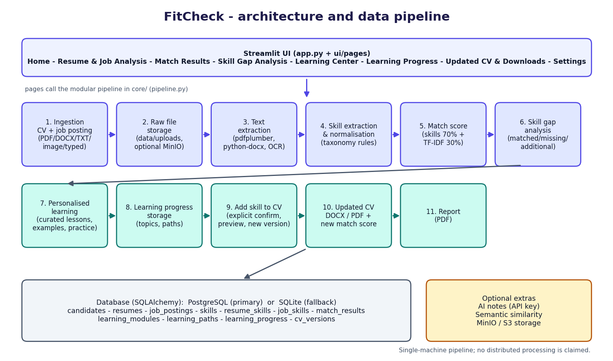

# FitCheck - Architecture

## Layers

| Layer | Modules | Responsibility |
|---|---|---|
| Presentation | `app.py`, `ui/pages/*.py`, `ui/theme.py`, `ui/charts.py`, `ui/state.py` | Streamlit pages, navigation, charts, session state |
| Pipeline | `core/pipeline.py` | Orchestrates the stages: analyse, add a skill to the CV, save an edited CV |
| Ingestion & extraction | `core/extraction.py`, `core/storage.py` | Validates uploads, reads PDF/DOCX/TXT/images (OCR fallback), keeps raw files |
| Skill intelligence | `core/taxonomy.py`, `core/skills.py` | Rule-based extraction, normalisation, required/preferred detection |
| Scoring | `core/matching.py` | Skill match, TF-IDF cosine similarity, optional semantic similarity, weighted final score, score explanation |
| Learning | `core/learning_content.py`, `core/content/*.py`, `core/ai.py` | Curated lessons, starter paths, practice questions, resources, optional AI notes |
| CV | `core/cv_builder.py` | Parse CV sections, safely add a skill, export DOCX/PDF |
| Persistence | `core/db.py`, `core/repository.py` | SQLAlchemy models, PostgreSQL primary / SQLite fallback, all reads and writes |
| Reporting | `core/report.py` | Downloadable PDF match report |

## Data pipeline (single machine)

1. **Resume and job posting ingestion** - files validated (type, size, signature) or text typed by the user.
2. **Raw file storage** - original bytes saved under `data/uploads/` and optionally mirrored to MinIO/S3.
3. **Text extraction** - embedded text first; OCR for scanned PDFs and images.
4. **Skill extraction and normalisation** - taxonomy rules map wording such as "ReactJS" to the canonical skill "React".
5. **Match score calculation** - `final = 0.7 x skill match + 0.3 x text similarity`.
6. **Skill gap analysis** - matched, missing required, missing preferred, additional skills.
7. **Personalised learning** - a learning path per missing skill with stages, lessons, practice and resources.
8. **Learning progress storage** - topic completion and path status in the database.
9. **Updated CV generation** - after explicit confirmation a new CV version is stored; the original is never changed.
10. **Final match score and report** - the score is recalculated for the new version; a PDF report is produced.

No distributed processing (Spark, Hadoop, Kafka) is used in the application itself. These technologies are the *subject of the
learning content* the application teaches.

## Database schema

| Table | Purpose | Key constraints |
|---|---|---|
| `candidates` | profile / session owner | PK, unique `display_name` |
| `resumes` | original resume metadata, original text, reviewed text | PK, FK -> candidates |
| `job_postings` | job text, source, synthetic flag | PK, FK -> candidates (nullable) |
| `skills` | canonical skill catalogue with category | PK, unique `name` |
| `resume_skills` | resume <-> skill mapping | composite PK, FKs |
| `job_skills` | job <-> skill mapping with importance | composite PK, FKs, CHECK importance in (required, preferred) |
| `match_results` | every analysis with weights and full details (JSON) | PK, FKs, CHECK 0 <= score <= 100 |
| `learning_modules` | one row per lesson topic | PK, FK -> skills, unique (skill, topic_key) |
| `learning_paths` | status per candidate and skill | PK, unique (candidate, skill), CHECK status |
| `learning_progress` | completed topics per candidate | PK, unique (candidate, module) |
| `cv_versions` | updated CV content (JSON + text) per resume | PK, FKs, unique (resume, version_no) |

All timestamps are stored in UTC. Writes run in short transactions through `session_scope()`, which rolls back on error.
Ready-made DDL: `db/schema_postgres.sql` and `db/schema_sqlite.sql`.

## Important design decisions

* **Original CV is immutable.** Every change creates a `cv_versions` row. The baseline score is always the first analysis of the
  original text, so the old and new scores can be compared.
* **Nothing is learned automatically.** Opening or completing lessons never changes the CV. Adding a skill needs a checkbox
  confirmation, a preview, and a button press.
* **Duplicate protection.** The skill is refused if it is already present (canonical name or exact wording).
* **Offline by default.** Taxonomy, lessons and TF-IDF need no internet or API key. AI, MinIO and sentence-transformers are optional.
* **Graceful degradation.** PostgreSQL unreachable -> SQLite; no Tesseract -> clear install message; AI missing -> built-in content.
* **Transparent score.** The formula is shown with the real numbers on the Results page.

## Testing

* `tests/test_skills_matching.py` - extraction, aliases, required/preferred detection, scoring arithmetic, synthetic dataset recovery.
* `tests/test_extraction_cv.py` - TXT/DOCX/PDF/image/scanned-PDF extraction, validation errors, CV parsing and safe skill insertion, exports.
* `tests/test_learning_content.py` - every curated path is complete; Python snippets compile.
* `tests/test_lesson_examples.py` - SQL, pandas, statistics and ML examples from the lessons are executed and their stated outputs checked.
* `tests/test_workflow_e2e.py` - the full workflow, database persistence, PostgreSQL/SQLite fallback.
* `tests/test_app_ui.py` - the real Streamlit app driven by `streamlit.testing.AppTest`: pages render, learning -> confirm -> add-to-CV works by clicking, uploads work.
